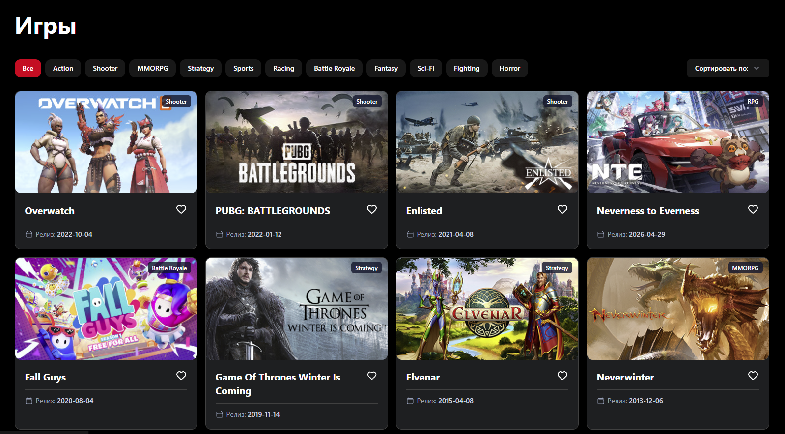
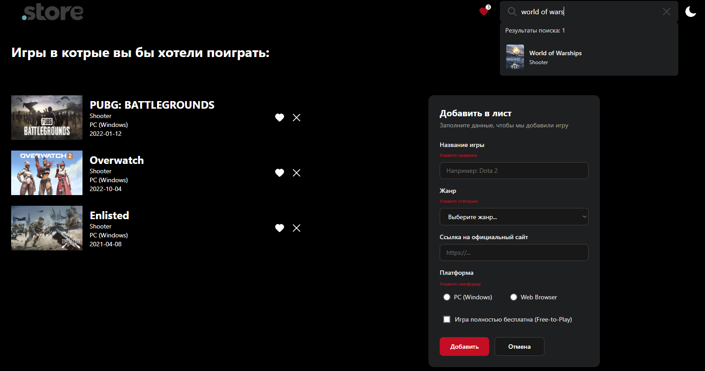

# GameStore

Каталог бесплатных игр с фильтрами, сортировкой, поиском и личным вишлистом.
Данные — [FreeToGame API](https://www.freetogame.com/api-docs).

**Демо:** https://valerontestesteron.github.io/gamestore




## Стек

React 19 · TypeScript · Redux Toolkit + RTK Query · React Router 7 · React Hook Form 7 · Tailwind CSS 4 · Vite · Vitest + React Testing Library

## Возможности

- Каталог игр через RTK Query: кэширование, дедупликация одинаковых запросов
- Фильтрация по жанрам, сортировка (дата выхода, алфавит, популярность)
- Фильтры хранятся в URL (`?category=strategy`) — ссылкой можно поделиться
- Поиск с дебаунсом (300 мс)
- Страница игры: описание, скриншоты (в каруселе), системные требования
- **Личный вишлист** — клиентская фича (у API нет такого эндпоинта):
  добавление/удаление, отметка «сыграл / хочу сыграть»,
  сохранение между сессиями в localStorage
- На странице /wishlist добавление своей игры в вишлист через форму (React Hook Form) с валидацией полей,
  запись сохраняется в localStorage
- Тёмная тема с сохранением выбора
- Скелетоны загрузки, попапы через createPortal
- Страница 404

## Запуск

```bash
git clone https://github.com/valerontestesteron/gamestore
cd gamestore
npm install
npm run dev     # http://localhost:5173
npm run test    # тесты
npm run build   # прод-сборка
```

## Деплой

GitHub Pages (project page). `base: '/gamestore/'` в `vite.config.ts`.

## Планы

- Ленивая загрузка страниц (React.lazy + Suspense)
- Тесты: Vitest + React Testing Library
- Адаптив
